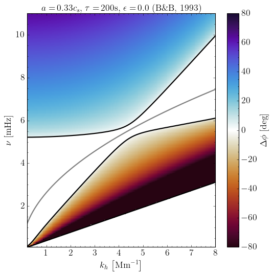

# Atmospheric Gravity Waves Modulated by the Magnetic Field Topology

This repository contains the code and notebooks used to produce Figure 4 from Vesa et al. (2025), "Atmospheric Gravity Waves Modulated by the Magnetic Field Topology."

All files required to reproduce the figures or to run your own experiments are in the `diagnostic_diagram` folder. Example notebooks demonstrate both symbolic manipulation of dispersion relations and the numerical pipeline used to generate the plots.

The code solves dispersion relations for a range of acoustic, gravity, and MHD waves to obtain the vertical wavenumber $k_z$, then computes phase-difference diagrams $\Delta \phi\left(\nu, k_h\right)$ as a function of frequency $\nu$ ($\nu = \omega / 2\pi$) and horizontal wavenumber $k_h$. Calculations assume the waves vertically propagate in the lower solar atmosphere.

# Requirements \& Installation

See ``requirements.txt`` file for a list of all required packages.
You can install them using pip:

```bash
pip install -r requirements.txt
```
For installation, you can clone the repository with:
  
```bash
git clone https://github.com/JulioM1823/Vesa_2025
```

# Features

- Analytic manipulation of dispersion relations (symbolic simplification and algebraic rearrangement).
- Computes the vertical wavenumber $k_z$ for all solution branches (acoustic, gravity, and MHD), including complex or imaginary roots.
- Generates phase-difference diagrams $\Delta\phi(\nu, k_h)$ as a function of frequency $\nu$ and horizontal wavenumber $k_h$.
- Identifies dispersion boundaries where $k_z^2 < 0$ and outputs the corresponding curves in $\nu-k_h$ space.

### Models Included

Below is a concise list of the models included in the code, with references and the most relevant parameters used in the calculations:

- [Newington & Cally (2009)](https://ui.adsabs.harvard.edu/abs/2010MNRAS.402..386N)  
    - Parameters:
        - $a$ — Alfvén speed
        - $\phi$ — angle between the projection of the magnetic field onto the $xz$-plane and the $z$-axis (not to be confused with the phase-difference $\Delta \phi$)
        - $\theta$ — angle between the wavenumber vector and the $z$-axis

- [Bunte & Bogdan (1993)](https://ui.adsabs.harvard.edu/abs/1994A&A...283..642B)  
    - Parameters:
        - $a$ — Alfvén speed
        - $\epsilon$ - Parameter that determines constant magnetic field strength or exponential decay of the magnetic field strength with height.
        - $\tau$ — radiative damping time in the lower solar atmosphere

- [Mihalas & Toomre (1982)](https://ui.adsabs.harvard.edu/abs/1982ApJ...263..386M)  
    - Parameters:
        - $\tau$ — radiative damping time in the lower solar atmosphere

- [Mihalas & Toomre (1981)](https://ui.adsabs.harvard.edu/abs/1981ApJ...249..349M)  
    - Model: Standard adiabatic acoustic–gravity wave model

- [Souffrin (1966)](https://ui.adsabs.harvard.edu/abs/1967ARA&A...5...67S)  
    - Model: Standard adiabatic acoustic–gravity wave model

# Usage and Examples

### Analytic Manipulation of Dispersion Relations
`diagnostic_diagram_analytic.ipynb` is a Jupyter notebook that collects the dispersion relations and provides tools to manipulate them symbolically with the ``SymPy`` package. It was used to rewrite the relations into forms suitable for the numerical calculation of the phase-difference diagrams, and can also be used to derive new dispersion relations or to analyze the properties of existing ones.

```python
# Import the relevant libraries
import sympy as sp
from sympy import sqrt, sin, cos, Rational
from sympy import Pow

# Define the coefficients
g  = sp.Symbol('self.g')
cs = sp.Symbol('self.cs')
N = sp.Symbol('self.N')
H = sp.Symbol('self.H')
omega = sp.Symbol('omega')
wac = sp.Symbol('self.wac')
gamma = sp.Symbol('self.gamma')
tau = sp.Symbol('self.tau')
kh  = sp.Symbol('kh')

# Define the equation for Mihalas and Toomre 1981 & Souffrin 1966
eq_mt81 = (pow(N, 2)*pow(kh, 2)/pow(omega, 2) + pow(omega, 2)/pow(cs, 2) -1/(4*pow(H, 2)) - pow(kh, 2))
eq_sf66 = (pow(omega, 2) - pow(wac, 2))/pow(cs, 2) - (pow(omega, 2) - pow(N, 2))*pow(kh, 2)/pow(omega, 2)

# Solve the dispersion relation for omega
roots_mt81 = sp.solve(eq_mt81, omega)

# Print the results in python code
print('Solutions for the Mihalas and Toomre 1981 dispersion relation')
print(sp.python(roots_mt81[0]))
print(sp.python(roots_mt81[1]))
print(sp.python(roots_mt81[2]))
print(sp.python(roots_mt81[3]))
```
Latex Output:
$\frac{\sqrt{2} \sqrt{4 c_{s}^{2} k_{h}^{2} + \frac{c_{s}^{2}}{H^{2}} - \frac{c_{s} \sqrt{- 64 H^{4} N^{2} k_{h}^{2} + 16 H^{4} c_{s}^{2} k_{h}^{4} + 8 H^{2} c_{s}^{2} k_{h}^{2} + c_{s}^{2}}}{H^{2}}}}{4}$

The computed results are printed as Python code, enabling direct copy-and-paste into other scripts.

Python Output:
```python
sqrt(2)*sqrt(4*cs**2*kh**2 + cs**2/H**2 - cs*sqrt(-64*H**4*N**2*kh**2 + 16*H**4*cs**2*kh**4 + 8*H**2*cs**2*kh**2 + cs**2)/H**2)/4
```

### Configuration File

`diagnostic_diagram_config.py` is the configuration module that defines all parameters for the available wave models. It contains physical constants, model-specific parameters, plot titles, and other settings read by the analysis code. To add or modify a model, update or add an entry in the configuration (e.g., the `params` dictionary).

### Generating Phase-Difference Diagrams $\left[\Delta \phi\left(\nu, k_h\right)\right]$
The analysis notebooks and scripts use the configuration file together with `diagnostic_diagram_functions.py` to compute $k_z$ over a grid of $\nu$ and $k_h$, derive phase-speeds, and evaluate the phase-differences $\Delta\phi(\nu, k_h)$ for a given input height separation $dz$ (in kilometers). Typical workflow: set the desired parameters in `diagnostic_diagram_config.py`, then run `diagnostic_diagram_analysis.ipynb` (or instantiate the `DiagnosticDiagram` class) to produce the diagnostic diagrams.

The module `diagnostic_diagram_functions.py` provides functions that accept a dispersion relation for a chosen model $\mathcal{D}$ and compute the vertical wavenumber $k_z$ by solving $\mathcal{D}=0$. Root finding is performed using `scipy.optimize.brentq`. The module also identifies the boundaries where $k_z^2<0$ (i.e., where waves are evanescent) and returns those boundaries as one-dimensional curves in $\nu-k_h$ space.

Below is a modified snippet from `diagnostic_diagram_analysis.ipynb` demonstrating how to use the module to generate phase-difference diagrams $\Delta\phi(\nu, k_h)$ for a range of acoustic, gravity, and magnetohydrodynamic models. It shows the typical workflow—loading configuration, computing $k_z$ and $\Delta\phi$ over the $\nu–k_h$ grid, and producing the diagnostic plots.

```python
# Import the relevant libraries
import diagnostic_diagram_config as dd_config
import diagnostic_diagram_functions as dd_funcs
import numpy as np
import matplotlib.colors as mcolors
import matplotlib.pyplot as plt
import matplotlib
import cmasher as cmr
from math import pi
from joblib import Parallel, delayed
from astropy.visualization import ZScaleInterval
from astropy.io import fits
from matplotlib import rc

# Create figure features
cmap_name = cmr.fusion
frequency_label = r'$\nu\,\left[\mathrm{mHz}\right]$'
wavenumber_label  = r'$k_{h}\,\left[\mathrm{Mm}^{-1}\right]$'
colorbar_label_kz = r'$k_{z}\,\left[\mathrm{km}^{-1}\right]$'
colorbar_label_phase = r'$\Delta\phi\,\left[\mathrm{deg}\right]$'

# Define grids
kh = np.linspace(0, 8, 200)*1e-3  # km^-1
omega = np.linspace(0, 11, 200)*2*pi*1e-3 # rad/s
kh_grid, omega_grid = np.meshgrid(kh, omega)  # km^-1, rad/s

# Intialize the diagnostic diagram
params = dd_config.params
model  = 'bunte1993'
diagram_class = dd_funcs.DiagnosticDiagram(kh_grid, omega_grid, params[model])

# Conversion factors
rad_to_mHz = (2*pi)**(-1)*1e3  # rad/s to mHz
inv_km_to_Mm = 1e3  # km^-1 to Mm^-1

# Calculate the bounds where kz^2 < 0 and calculate kz
nu = np.array(Parallel(n_jobs = -1, backend = 'loky')(delayed(diagram_class.omega_solve)(i) for i in kh))*rad_to_mHz
kz = np.stack(Parallel(n_jobs = -1, backend = 'loky')(delayed(diagram_class.kz_solve)(i) for i in kh), axis = 1)

# Calculate grids and f-mode dispersion for plotting
kh_plot  = kh_grid*inv_km_to_Mm # Mm^-1
nu_plot  = omega_grid*rad_to_mHz  # mHz
fmode_nu = diagram_class.fmode_dispersion()*rad_to_mHz

# Calculate the corresponding phase speed and phase difference per kz mode
v_phase = [diagram_class.phase_speed(omega_grid, kz[:, :, n]) for n in range(params[model]['kz_order'])]  # km/s
delta_phi = [diagram_class.phase_difference(omega_grid, v_phase[n], dd_config.dz) for n in range(params[model]['kz_order'])]  # rad

# Define the color scale for the phase differences
interval = ZScaleInterval()

# Plot the phase differences
for i in range(0, params[model]['kz_order']):
    phase_difference = np.nan_to_num(delta_phi[i]*180*pi**(-1), nan = 0.0, posinf=0.0, neginf=0.0) # degrees
    if np.all(np.isclose(phase_difference, 0.0, rtol=1e-09, atol=1e-09)):
        plt.close()
        continue
    # Make the plot
    plt.figure(figsize=(7, 7))
    plt.plot(kh_plot[0], fmode_nu, 'gray')
    if (model == 'nc2009'):
        plt.plot(kh_plot[0], kh*(dd_config.ax*rad_to_mHz), color='black', linestyle='-')
    vmin, vmax = -80, 80
    plt.pcolormesh(kh_plot, nu_plot, phase_difference, cmap=cmr.fusion, shading="auto", norm=mcolors.TwoSlopeNorm(vmin=vmin, vcenter=0.0, vmax=vmax), rasterized=True)
    plt.colorbar(label=colorbar_label_phase)
    for j in range(0, params[model]['omega_order']):
        plt.plot(kh_plot[0], nu[:, j], 'k-', markersize=3)
    plt.title(f'Diagnostic Diagram for {diagram_class.model.upper()}')
    plt.xlabel(wavenumber_label)
    plt.ylabel(frequency_label)
    plt.xlim(0.2, np.max(kh_plot))
    plt.ylim(0.1, np.max(nu_plot))
    plt.tight_layout()
    plt.title(params[model]['title'])
    plt.show()
    break  # Remove this line to plot all kz modes
```

Example output for the Bunte & Bogdan (1993) model, showing results for a uniform horizontal magnetic field (Alfvén speed $a$) and radiative damping time $\tau$:
<p align="center">
    
</p>

# Known issues and limitations

- Solutions for $k_z$ (and therefore $\Delta\phi$) are not always smoothly varying with respect to $k_h$ and $\nu$. This behavior likely arises from the mathematical structure of the dispersion relations and the numerical root-finding methods. It is a visualization artifact and does not change the physical interpretation of the results.

- The code expects dispersion relations to be expressible as an $n^{\text{th}}$ order polynomial in $k_z$:
    $$c_{n}k_z^{n} + c_{n-1}k_z^{n-1} + \dots + c_0 = 0,$$
    where each coefficient $c_n(\nu, k_h, \ldots)$ depends on $\nu$, $k_h$, and the model parameters. The pipeline uses these coefficients to compute $k_z$ for each $(\nu, k_h)$. Dispersion relations that cannot be written in this polynomial form require algebraic rearrangement (for example, via ``diagnostic_diagram_analytic.ipynb``) before they will work with the code.

- Finding the boundaries where $k_z^2 < 0$ has the same requirement: the boundary condition must be cast as an $n^{\text{th}}$ order polynomial in $\omega$,
    $$b_{n}\omega^{n} + b_{n-1}\omega^{n-1} + \dots + b_0 = 0,$$
    with coefficients $b_n(k_h,\ldots)$ that depend on $k_h$ and the physical parameters.

- Solutions for $\nu$ near the origin can be numerically unstable, producing small, nonphysical curvature in the boundary curves (see the example above in the previous section). This is a limitation of the current numerical approach and does not materially affect the overall results.

# Future improvements

- Replace or augment the current root-finding strategy with more robust numerical methods to improve smoothness and stability of $k_z$ and $\Delta\phi$ across the grid.

- Remove the reliance on a particular polynomial form by generalizing the solver to accept a wider class of dispersion relations directly.
  
# Author(s)

- Julio M. Morales-[@JulioM1823](https://github.com/JulioM1823)
- Oana Vesa-[@ovesa](https://github.com/ovesa)
