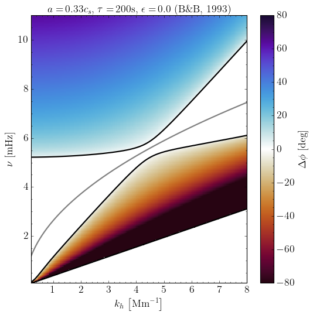

# Atmospheric Gravity Waves Modulated by the Magnetic Field Topology

This repository contains the code and notebooks used to produce Figure 4 from Vesa et al. (2025), "Atmospheric Gravity Waves Modulated by the Magnetic Field Topology."

All files required to reproduce the figures or to run your own experiments are in the `diagnostic_diagram` folder. Example notebooks demonstrate both symbolic manipulation of dispersion relations and the numerical pipeline used to generate the plots.

The code solves dispersion relations for a range of acoustic, gravity, and MHD waves to obtain the vertical wavenumber $k_z$, then computes phase-difference diagrams $\Delta \phi\left(\nu, k_h\right)$ as a function of frequency $\nu$ ($\nu = \omega / 2\pi$) and horizontal wavenumber $k_h$. Calculations assume the waves vertically propagate in the lower solar atmosphere.

# Requirements \& Installation

See ``requirements.txt`` file for a list of all required packages.
You can install them using pip:

```bash
pip install -r requirements.txt
```
For installation, you can clone the repository with:
  
```bash
git clone https://github.com/JulioM1823/Vesa_2025
```

# Features

- Analytic manipulation of dispersion relations (symbolic simplification and algebraic rearrangement).
- Computes the vertical wavenumber $k_z$ for all solution branches (acoustic, gravity, and MHD), including complex or imaginary roots.
- Generates phase-difference diagrams $\Delta\phi(\nu, k_h)$ as a function of frequency $\nu$ and horizontal wavenumber $k_h$.
- Identifies dispersion boundaries where $k_z^2 < 0$ and outputs the corresponding curves in $\nu-k_h$ space.

### Models Included

Below is a concise list of the models included in the code, with references and the most relevant parameters used in the calculations:

- [Newington & Cally (2009)](https://ui.adsabs.harvard.edu/abs/2010MNRAS.402..386N)  
    - Parameters:
        - $a$ — Alfvén speed
        - $\phi$ — angle between the projection of the magnetic field onto the $xz$-plane and the $z$-axis (not to be confused with the phase-difference $\Delta \phi$)
        - $\theta$ — angle between the wavenumber vector and the $z$-axis

- [Bunte & Bogdan (1993)](https://ui.adsabs.harvard.edu/abs/1994A&A...283..642B)  
    - Parameters:
        - $a$ — Alfvén speed
        - $\epsilon$ - Parameter that determines constant magnetic field strength or exponential decay of the magnetic field strength with height.
        - $\tau$ — radiative damping time in the lower solar atmosphere

- [Mihalas & Toomre (1982)](https://ui.adsabs.harvard.edu/abs/1982ApJ...263..386M)  
    - Parameters:
        - $\tau$ — radiative damping time in the lower solar atmosphere

- [Mihalas & Toomre (1981)](https://ui.adsabs.harvard.edu/abs/1981ApJ...249..349M)  
    - Model: Standard adiabatic acoustic–gravity wave model

- [Souffrin (1966)](https://ui.adsabs.harvard.edu/abs/1967ARA&A...5...67S)  
    - Model: Standard adiabatic acoustic–gravity wave model

- Slow-fast mode
    - Parameters: $a$, $c_s$, $\theta$, and $\phi$
    - A quartic $\omega$ equation with two positive-frequency boundary slots (`omega_order = 2`) and `kz_order = 4`

# Usage and Examples

### Analytic Manipulation of Dispersion Relations
`analytic.ipynb` is a Jupyter notebook that collects the dispersion relations and provides tools to manipulate them symbolically with the ``SymPy`` package. It was used to rewrite the relations into forms suitable for the numerical calculation of the phase-difference diagrams, and can also be used to derive new dispersion relations or to analyze the properties of existing ones.

```python
# Import the relevant libraries
import sympy as sp
from sympy import sqrt, sin, cos, Rational
from sympy import Pow

# Define the coefficients
g  = sp.Symbol('self.g')
cs = sp.Symbol('self.cs')
N = sp.Symbol('self.N')
H = sp.Symbol('self.H')
omega = sp.Symbol('omega')
wac = sp.Symbol('self.wac')
gamma = sp.Symbol('self.gamma')
tau = sp.Symbol('self.tau')
kh  = sp.Symbol('kh')

# Define the equation for Mihalas and Toomre 1981 & Souffrin 1966
eq_mt81 = (pow(N, 2)*pow(kh, 2)/pow(omega, 2) + pow(omega, 2)/pow(cs, 2) -1/(4*pow(H, 2)) - pow(kh, 2))
eq_sf66 = (pow(omega, 2) - pow(wac, 2))/pow(cs, 2) - (pow(omega, 2) - pow(N, 2))*pow(kh, 2)/pow(omega, 2)

# Solve the dispersion relation for omega
roots_mt81 = sp.solve(eq_mt81, omega)

# Print the results in python code
print('Solutions for the Mihalas and Toomre 1981 dispersion relation')
print(sp.python(roots_mt81[0]))
print(sp.python(roots_mt81[1]))
print(sp.python(roots_mt81[2]))
print(sp.python(roots_mt81[3]))
```
Latex Output:
$\frac{\sqrt{2} \sqrt{4 c_{s}^{2} k_{h}^{2} + \frac{c_{s}^{2}}{H^{2}} - \frac{c_{s} \sqrt{- 64 H^{4} N^{2} k_{h}^{2} + 16 H^{4} c_{s}^{2} k_{h}^{4} + 8 H^{2} c_{s}^{2} k_{h}^{2} + c_{s}^{2}}}{H^{2}}}}{4}$

The computed results are printed as Python code, enabling direct copy-and-paste into other scripts.

Python Output:
```python
sqrt(2)*sqrt(4*cs**2*kh**2 + cs**2/H**2 - cs*sqrt(-64*H**4*N**2*kh**2 + 16*H**4*cs**2*kh**4 + 8*H**2*cs**2*kh**2 + cs**2)/H**2)/4
```

### Configuration File

`config.py` is the configuration module that defines all parameters for the available wave models. It contains physical constants, model-specific parameters, plot titles, and other settings read by the analysis code. To add or modify a model, update or add an entry in the configuration (e.g., the `params` dictionary).

### Generating Phase-Difference Diagrams $\left[\Delta \phi\left(\nu, k_h\right)\right]$
The analysis notebooks and scripts use the configuration file together with `functions.py` to compute $k_z$ over a grid of $\nu$ and $k_h$, derive phase-speeds, and evaluate the phase-differences $\Delta\phi(\nu, k_h)$ for a given input height separation $dz$ (in kilometers). Typical workflow: set the desired parameters in `config.py`, then run `analysis.ipynb` (or instantiate the `DiagnosticDiagram` class) to produce the diagnostic diagrams.

The module `functions.py` provides functions that accept a dispersion relation for a chosen model $\mathcal{D}$ and compute the vertical wavenumber $k_z$ by solving $\mathcal{D}=0$. Vertical-wavenumber roots are solved as complex polynomial roots and then assigned to continuous branches across the full $\nu-k_h$ grid. Dispersion-boundary frequencies are likewise solved directly as complete complex root sets and continuity-tracked along $k_h$; only nonnegative, numerically real roots inside the sampled frequency interval are exposed as plotted boundaries.

Below is a modified snippet from `analysis.ipynb` demonstrating how to use the module to generate phase-difference diagrams $\Delta\phi(\nu, k_h)$ for a range of acoustic, gravity, and magnetohydrodynamic models. It shows the typical workflow—loading configuration, computing $k_z$ and $\Delta\phi$ over the $\nu–k_h$ grid, and producing the diagnostic plots.

```python
# Import the relevant libraries
import config as dd_config
import functions as dd_funcs
import numpy as np
import matplotlib.colors as mcolors
import matplotlib.pyplot as plt
import matplotlib
import cmasher as cmr
from math import pi
from astropy.visualization import ZScaleInterval
from astropy.io import fits
from matplotlib import rc

# Create figure features
cmap_name = cmr.fusion
frequency_label = r'$\nu\,\left[\mathrm{mHz}\right]$'
wavenumber_label  = r'$k_{h}\,\left[\mathrm{Mm}^{-1}\right]$'
colorbar_label_kz = r'$k_{z}\,\left[\mathrm{km}^{-1}\right]$'
colorbar_label_phase = r'$\Delta\phi\,\left[\mathrm{deg}\right]$'

# Define grids
kh = np.linspace(0, 8, 200)*1e-3  # km^-1
omega = np.linspace(0, 11, 200)*2*pi*1e-3 # rad/s
kh_grid, omega_grid = np.meshgrid(kh, omega)  # km^-1, rad/s

# Intialize the diagnostic diagram
params = dd_config.params
model  = 'bunte1993'
diagram_class = dd_funcs.DiagnosticDiagram(kh_grid, omega_grid, params[model])

# Conversion factors
rad_to_mHz = (2*pi)**(-1)*1e3  # rad/s to mHz
inv_km_to_Mm = 1e3  # km^-1 to Mm^-1

# Calculate tracked omega-boundary and kz branches over their complete grids
omega_boundaries, omega_tracking = diagram_class.omega_solve_grid(return_diagnostics=True)
kz, kz_tracking = diagram_class.kz_solve_grid(return_diagnostics=True)
omega_boundaries_by_kz, omega_kz_tracking = diagram_class.associate_omega_boundaries_with_kz(
    omega_boundaries, kz, return_diagnostics=True
)

# Calculate grids and f-mode dispersion for plotting
kh_plot  = kh_grid*inv_km_to_Mm # Mm^-1
nu_plot  = omega_grid*rad_to_mHz  # mHz
fmode_nu = diagram_class.fmode_dispersion()*rad_to_mHz

# Calculate the corresponding phase speed and phase difference per kz mode
v_phase = [diagram_class.phase_speed(omega_grid, kz[:, :, n]) for n in range(params[model]['kz_order'])]  # km/s
delta_phi = [diagram_class.phase_difference(omega_grid, v_phase[n], dd_config.dz) for n in range(params[model]['kz_order'])]  # rad

# Define the color scale for the phase differences
interval = ZScaleInterval()

# Plot the phase differences
for i in range(0, params[model]['kz_order']):
    phase_difference = np.real(np.nan_to_num(delta_phi[i]*180*pi**(-1), nan = 0.0, posinf=0.0, neginf=0.0)) # degrees
    if np.all(np.isclose(phase_difference, 0.0, rtol=1e-09, atol=1e-09)):
        plt.close()
        continue
    # Make the plot
    plt.figure(figsize=(7, 7))
    plt.plot(kh_plot[0], fmode_nu, 'gray')
    vmin, vmax = -80, 80
    plt.pcolormesh(kh_plot, nu_plot, phase_difference, cmap=cmr.fusion, shading="auto", norm=mcolors.TwoSlopeNorm(vmin=vmin, vcenter=0.0, vmax=vmax), rasterized=True)
    plt.colorbar(label=colorbar_label_phase)
    # Overlay only boundary curves stitched to this tracked kz/phase family.
    diagram_class.plot_omega_boundaries_for_kz_branch(
        plt.gca(), omega_boundaries_by_kz, i
    )
    plt.title(f'Diagnostic Diagram for {diagram_class.model.upper()}')
    plt.xlabel(wavenumber_label)
    plt.ylabel(frequency_label)
    plt.xlim(0.2, np.max(kh_plot))
    plt.ylim(0.1, np.max(nu_plot))
    plt.tight_layout()
    plt.title(params[model]['title'])
    plt.show()
    break  # Remove this line to plot all kz modes
```

### Inspecting $\omega$ Boundary Tracking

`omega_solve_grid()` constructs coefficients with `omega_coefficients()`, solves every polynomial directly, matches adjacent complex root sets with one-to-one Hungarian assignment, and propagates labels along the physical $k_h$ coordinates. Its public array has shape `(n_kh, omega_order)` and contains only nonnegative, numerically real roots in the sampled frequency interval; unavailable values are `NaN`. Complete negative and complex roots remain in `omega_tracking['raw_roots']` and `omega_tracking['tracked_roots']`. Reduced degree, failed solves, reinitializations, degeneracies, ambiguous assignments, and normalized residuals are reported separately. The old `omega_solve(kh)` remains only as a zero-filled, single-$k_h$ compatibility method.

Before overlaying these curves on a phase-difference panel, call `associate_omega_boundaries_with_kz()`. At each positive boundary point it verifies an exact $k_z=0$ root, continues that root through eight configurable substeps to the strict sampled-frequency rows below and above the boundary, and matches both endpoint root sets to the global labels returned by `kz_solve_grid()`. Lower/upper label disagreement is retained and flagged rather than hidden by interpolating or sorting solver slots.

The pointwise labels can hand off repeatedly near a crossing, while the same continuous omega curve remains a boundary of a global phase family. The default association therefore stitches a curve across each connected finite $k_h$ interval only after three consecutive support samples (also checked using physical $k_h$ span); isolated near-origin contacts are rejected. Missing/NaN gaps are never bridged, and a zero-frequency endpoint is included only as the limit of an adjacent qualified curve. The local two-sided evidence, stitched pixels, endpoint extensions, support counts/spans, component membership, confidence, and ambiguity masks are returned in `omega_kz_tracking`. Both the continuation substeps and support thresholds are configurable.

For the configured NC2009 case this gives the intended mapping: phase branches 1–2 receive no omega curves; branches 3–4 receive the middle and upper curves; branch 5 receives the middle curve; and branch 6 receives only the lower coupled boundary. The separate $a_xk_h$ approximation is not plotted.


```python
omega_boundaries, omega_tracking = diagram_class.omega_solve_grid(
    return_diagnostics=True
)
kz, kz_tracking = diagram_class.kz_solve_grid(return_diagnostics=True)
omega_boundaries_by_kz, omega_kz_tracking = diagram_class.associate_omega_boundaries_with_kz(
    omega_boundaries, kz, return_diagnostics=True
)

fig, axes = diagram_class.plot_omega_tracking_comparison(
    omega_boundaries,
    omega_tracking
)
```


### Inspecting $k_z$ Branch Tracking

`kz_solve_grid()` returns roots after continuity-based branch assignment across the full $\nu-k_h$ grid. After the initial spanning-tree assignment, a global pair-swap synchronization pass relabels connected regions where two branches were exchanged across an artificial cut. A second identity-refinement pass tests larger candidate region swaps against a global first- and second-difference objective in both complex $k_z$ and $\mathrm{Re}(k_z)$, which is proportional to $\Delta\phi$. Candidate swaps are applied only when they improve the global objective; otherwise close-root regions are exposed as true near-degeneracies/crossings. The raw root order and pre-swap roots are still available in the diagnostics dictionary so the tracked branches can be compared against the numerical solver ordering. The diagnostics also separate branch-label jumps from polynomial-solve problems using root-set jump maps, assignment confidence/cost, root separation, and normalized polynomial residuals:

The point solver now rescales $k_z=R y$ before finding roots and removes only exactly zero leading coefficients. `effective_degree` and `degree_reduced_mask` distinguish physical degree changes from `solve_failed_mask`. `root_residuals` use the actual magnitudes of polynomial terms, and `root_condition_estimates` flag roots sensitive to coefficient perturbations; a small residual alone is not a bound on root error. For selected sensitive points, `kz_solve_grid(high_precision_validation=True)` independently resolves the root sets with `mpmath` and reports agreement or failure in `high_precision_validation`. This check requires `mpmath` and can be slow. Branch identities at degeneracies still require physical interpretation.

```python
kz, kz_tracking = diagram_class.kz_solve_grid(return_diagnostics=True)

# Plot every tracked branch on one shared color scale.
fig, axes = diagram_class.plot_kz_branches(
    kz,
    component='real',
    diagnostics=kz_tracking,
    robust=False
)

# For custom per-branch figures, compute the color limits once and reuse them.
kz_plot = diagram_class.kz_plot_values(
    kz,
    component='real',
    diagnostics=kz_tracking
)
kz_vmin, kz_vmax = diagram_class.kz_color_limits(
    kz,
    component='real',
    diagnostics=kz_tracking,
    robust=False
)

# Compare raw solver ordering against tracked ordering and show suspicious regions.
fig, axes = diagram_class.plot_kz_tracking_diagnostics(
    kz_tracking['raw_roots'],
    kz,
    kz_tracking
)

print(kz_tracking['smoothness'])
print('Suspicious pixels:', np.count_nonzero(kz_tracking['uncertain_mask']))
print('Pre-swap branch-jump excess pixels:', np.count_nonzero(kz_tracking['pre_swap_branch_jump_excess_mask']))
print('Post-swap branch-jump excess pixels:', np.count_nonzero(kz_tracking['branch_jump_excess_mask']))
print('Flagged plot-artifact pixels:', np.count_nonzero(kz_tracking['plot_suspicious_mask']))
print('Branch-swap correction:', {
    key: value for key, value in kz_tracking['branch_swap_correction'].items()
    if key != 'pair_stats'
})
print('Branch-identity refinement:', {
    key: value for key, value in kz_tracking['branch_identity_refinement'].items()
    if key != 'pair_stats'
})
print('Nearly degenerate pixels:', np.count_nonzero(kz_tracking['degenerate_mask']))
print('Close branch-pair pixels:', np.count_nonzero(kz_tracking['branch_close_mask']))
print('Topological branch-cut pixels:', np.count_nonzero(kz_tracking['topological_branch_cut_mask']))
print('Unresolved branch-jump pixels:', np.count_nonzero(kz_tracking['unresolved_branch_jump_mask']))
print('High-residual solve pixels:', np.count_nonzero(kz_tracking['solver_instability_mask']))
print('Worst polynomial residual:', np.nanmax(kz_tracking['max_root_residual']))

# Before/after kz and phase maps for selected affected branches.
fig, axes = diagram_class.plot_branch_swap_diagnostics(
    kz,
    kz_tracking,
    branches=[1, 2, 4],
    dz=dd_config.dz
)

# Inspect whether a suspected large-scale boundary is a real branch swap.
# branch_pair uses one-based branch numbers; omit it to inspect the closest pair.
fig, axes = diagram_class.plot_branch_identity_diagnostics(
    kz,
    kz_tracking,
    branch_pair=(1, 4),
    dz=dd_config.dz
)

# Distinguish numerical artifacts from unavoidable root-sheet branch cuts.
fig, axes = diagram_class.plot_branch_topology_diagnostics(
    kz,
    kz_tracking,
    branch=2,
    dz=dd_config.dz
)

# Optional line cuts through a suspicious region.
fig, ax = diagram_class.plot_kz_line_cut(kz, axis='kh', index=100, component='real')
```

Example output for the Bunte & Bogdan (1993) model, showing results for a uniform horizontal magnetic field (Alfvén speed $a$) and radiative damping time $\tau$:
<p align="center">
    
</p>

# Interactive Bokeh application

An interactive Bokeh server application is available for all six requested
dispersion families. It reuses the existing root solving, continuity tracking,
boundary verification/stitching, and phase-difference calculations.

```bash
.venv/bin/pip install -r requirements.txt
.venv/bin/bokeh serve --show Code/diagnostic_diagram/bokeh_app
```

The application uses model-local all-slider controls, live debounced Python
callbacks, cached identical evaluations, selectable `k_z`/phase views, verified
boundary overlays, numerical-warning masks, and interactive hover/pan/zoom/reset
tools. Every tracked solution is shown simultaneously in a linked 2-, 4-, or
6-panel grid, and one model calculation updates all of its panels. A robust
full-sheet complex-`k_z` assignment stabilizes panel identity between parameter
changes without altering the solver's pointwise roots. Its 700×700 plots use the
same labels, serif styling, black boundary overlays, `cmasher.fusion` phase
colormap, and normalization as the notebook pipeline. See
[`Code/diagnostic_diagram/INTERACTIVE_APP.md`](Code/diagnostic_diagram/INTERACTIVE_APP.md)
for the complete control list, performance measurements, validation command,
and current scientific limitations.

# Known issues and limitations

- Raw solver output for $k_z$ is not branch ordered. Use `kz_solve_grid()` for continuity-tracked branches and inspect `kz_tracking['uncertain_mask']`, `kz_tracking['branch_close_mask']`, and `kz_tracking['branch_degenerate_mask']` where the assignment is close to a degeneracy or crossing. The branch-swap and identity-refinement passes should drive `kz_tracking['unresolved_branch_jump_mask']` to zero; if any pixels remain in `kz_tracking['plot_suspicious_mask']`, pass `diagnostics=kz_tracking, mask_suspicious=True` so they are visibly flagged instead of appearing as branch structure. If sharp features remain but `plot_suspicious_mask` is empty, inspect `kz_tracking['topological_branch_cut_mask']` and `kz_tracking['monodromy_mask']`; these mark root-sheet branch cuts caused by non-identity local root permutations around a plaquette, not polynomial-solver failures.

- The code expects dispersion relations to be expressible as an $n^{\text{th}}$ order polynomial in $k_z$:
    $$c_{n}k_z^{n} + c_{n-1}k_z^{n-1} + \dots + c_0 = 0,$$
    where each coefficient $c_n(\nu, k_h, \ldots)$ depends on $\nu$, $k_h$, and the model parameters. The pipeline uses these coefficients to compute $k_z$ for each $(\nu, k_h)$. Dispersion relations that cannot be written in this polynomial form require algebraic rearrangement (for example, via ``analytic.ipynb``) before they will work with the code.

- Finding the boundaries where $k_z^2 < 0$ has the same requirement: the boundary condition must be cast as an $n^{\text{th}}$ order polynomial in $\omega$,
    $$b_{n}\omega^{n} + b_{n-1}\omega^{n-1} + \dots + b_0 = 0,$$
    with coefficients $b_n(k_h,\ldots)$ that depend on $k_h$ and the physical parameters.

- Solutions for $\nu$ near the origin can be numerically unstable, producing small, nonphysical curvature in the boundary curves (see the example above in the previous section). This is a limitation of the current numerical approach and does not materially affect the overall results.

# Future improvements

- Further tune branch-tracking thresholds for model-specific degeneracies and use the diagnostic masks to separate true crossings from numerical assignment uncertainty.

- Remove the reliance on a particular polynomial form by generalizing the solver to accept a wider class of dispersion relations directly.
  
# Author(s)

- Julio M. Morales-[@JulioM1823](https://github.com/JulioM1823)
- Oana Vesa-[@ovesa](https://github.com/ovesa)
